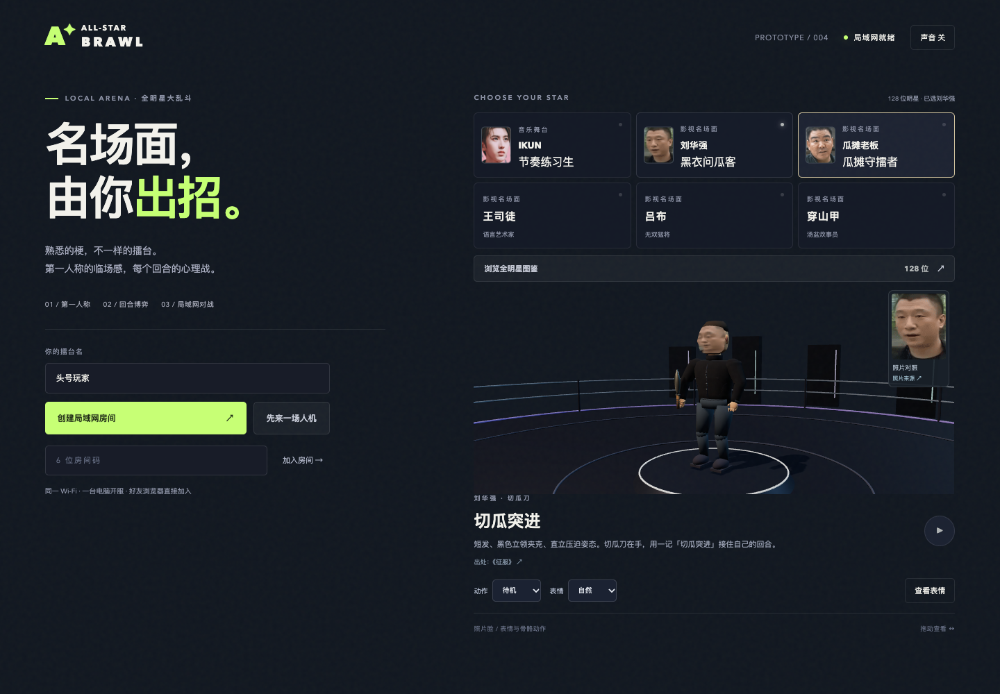

# All-Star Brawl · 全明星大乱斗

A playable **first-person, turn-based LAN arena** featuring cartoon meme fighters and three photo-face experiments. Inspired by the short turns, exaggerated moves and punchy feedback of Q 宠大乐斗.

一款第一人称、同步选招、局域网联机的梗人物对战原型。双方站在同一擂台，每回合选招，随后观看出招、命中与收招；先赢两局获胜。

`v0.4.0` 将当前调研集合扩展为 **128 位可选角色**，包括华强、瓜摊老板、赵本山、范伟、成龙、吴京、诸葛亮、燕双鹰，以及直播电竞、音乐舞台和网络人物。首页提供 6 位常用角色；打开图鉴后可按姓名、别名、作品搜索，按分类筛选，并查看出处链接。完整名单和身份辨别见 [角色调研](docs/ROSTER_RESEARCH.md)。

128 位是截至 **2026-10-13** 的研究集合；鬼畜全明星没有固定的官方全集，这份名册会继续扩展。



[125 位新增人物精修图集](docs/character-refinement-gallery.html) · [精修前后对照](docs/character-refinement-comparison.jpg) · [第一人称对战演示](docs/roster-demo.mp4) · [美术与动作说明](docs/ART_AND_ANIMATION.md)

IKUN、华强与瓜摊老板已试用**真实照片头像和立体曲面脸贴图**，保留眨眼、生气、开心与受伤变化。照片来源、署名和具体制作方式见 [照片素材记录](docs/PHOTO_ASSETS.md)。其余 125 位采用风格化脸部。本轮重新制作了全部 125 位新增人物的造型配置、脸部曲面、发束、服装细节和关节权重；照片覆盖仍为三位，未宣称逐人完成真人扫描。

## 开始游戏

主机需要 **Node.js 22 或更新版本**。推荐桌面 Chrome / Edge。

```bash
git clone https://github.com/HongfeiWan/all-star-brawl.git
cd all-star-brawl
npm ci
npm start
```

主机打开 **http://localhost:3000**。

1. 选择角色，输入昵称，点击「创建局域网房间」。
2. 将大厅显示的 **主机局域网地址** 和 **6 位房间码** 告诉好友，或点击「复制邀请」。
3. 好友在同一 Wi-Fi / 有线局域网中打开该地址，选择角色后加入房间。
4. 两人入场后，房主点击「开始对战」。

好友输入的地址应类似 `http://192.168.1.20:3000`；该 IP 是主机的地址。每台设备的 `localhost` 指向它自己。主机只需安装一次依赖，此后启动和对战不需要 CDN、外部账号或云服务。

一个人体验：点击「先来一场人机」。可打开两个浏览器标签页模拟两名玩家。

## 玩法与操作

- 每回合有 **8 秒** 同时选招。对手只能看到是否锁定，无法提前看到招式。
- 按 **1–4** 选招，按 **Enter** 锁定，也可点击招式和锁定按钮。
- 时间用尽自动格挡。双方都锁定后立即开始演出。
- 固定站位第一人称：拖动场景或用方向键转动视角；「锁定视角」启用鼠标视角，**Esc** 释放鼠标。
- 画面包含蓄势、620 毫秒接触、收招与 38–88 毫秒命中停顿；手部、武器和骨骼同步，配合短促镜头回弹、接触火花与伤害反馈。声音按钮开启分层合成音效。
- 每局最多 20 回合，超时按剩余生命百分比判胜。双方伤害从同一初始状态结算，支持双 KO；平局重开该局。
- **三局两胜**，可在结束后再战。断线时房间回到准备阶段；空房间自动清理。

| 招式 | 消耗 | 效果 |
| --- | --- | --- |
| 快攻 | 0 | 18 伤害，获得 1 点气势 |
| 重击 | 1 | 30 伤害；对格挡仍造成 24 伤害 |
| 格挡 | 0 | 减少 70% 普通伤害，获得 1 点气势 |
| 绝招 | 2 | 使用角色专属招式 |

气势最多 3 点，初始 1 点。格挡后的伤害四舍五入；快攻命中格挡为 5 点伤害。

| 角色 | 生命 | 绝招 | 角色特征 |
| --- | --- | --- | --- |
| IKUN | 108 | 节奏暴扣 · 34 伤害 | 银发、背带、篮球与蓄力暴扣 |
| 王司徒 | 116 | 言语破防 · 30 伤害 | 官帽、白须、羽扇；额外消耗对手 1 气势 |
| 吕布 | 100 | 天下无双 · 40 伤害 | 赤金战甲、双翎、方天画戟与横扫 |

原三位保留上述数值。新增角色的生命在 **100–116**、绝招伤害在 **30–40** 之间，先约束在现有强度区间，避免扩展后数值膨胀；尚未做玩家平衡评测。第一人称手指、袖口与武器使用独立的前景视角模型。

## 角色与动作制作

仓库包含可直接运行的 GLB、可编辑的核心人物源文件和可复现的制作工具：

- 原三位：`art/all-stars.blend`，以及 `public/assets/ikun.glb`、`wang.glb`、`lubu.glb`。每人 16 根骨骼、4 个面部控制和 7 个内嵌动作，共 21 个片段。
- 新增 125 位：`public/assets/roster/<id>.glb`，每位是独立模型，含 16 根骨骼及 **blink / angry / smile / hurt** 四个面部控制。
- 新人物共用 `public/assets/motions/` 中的 **knife / orb / staff / brawler** 四个动作族，每族包含 **idle / attack / heavy / guard / special / hurt / victory** 七个片段。连同原三位，实际储存 **49 个动画片段**；角色数量不等于独占动作数量。
- 新增 125 份模型合计约 **130.6 MiB**，单体约 **0.55–1.83 MiB**、**17.8k–59.6k 三角面**，含华强和瓜摊老板的照片曲面。游戏按需载入人物，将模型缓存控制在 12 个，并复用动作库。资源统计和检查见 [验证记录](docs/VALIDATION.md)。
- `art/character-profiles.json`：全部 125 位新增人物各自的造型、面部比例、出处、解释与推断记录。
- `art/huaqiang.blend`、`guatan.blend`、`zhugeliang.blend`、`zhangfei.blend`、`snowking.blend`、`wukong.blend`、`tangseng.blend`、`bajie.blend`：八位代表人物的可编辑源文件，包含分件、骨架、表情与共享动作；其他人物可用同一工具按 ID 保存。
- `shared/roster.js` 保存调研名册；`shared/roster-contacts.js` 保存实际模型视觉配置、动作族与 620 毫秒接触点。运行时优先采用实际模型的道具配置。
- `tools/make_characters.py` 制作原三位；`tools/make_roster.py` 与 `tools/refine_roster.py` 制作新增人物、服饰分件、平滑蒙皮、动作库与对应元数据。
- `tools/apply_photo_faces.py` 与 `art/photo-faces.json` 可复现三位照片脸：按眼、鼻、嘴及脸缘标记校正 UV，图片内嵌 GLB，局域网使用不依赖在线图片服务。原 `.blend` 文件保留程序化脸部基础。

首页可预览 **7 个动作**和**自然 / 生气 / 疼痛 / 开心**四种表情，并切换脸部特写。自然眨眼、待机呼吸、受击后的小幅回弹与思考时的侧看，让人物随战斗状态变化。

模型制作使用 Blender 5.1.1，攻击片段以 100 fps 制作，620 毫秒接触对齐第 62 帧。Three.js 使用 `AnimationMixer` 和 100 毫秒交叉淡入衔接；命中停顿后在同一服务器时段内完成回收。可以在 Blender 的非线性动画编辑器查看同名轨道；选中轨道并取消静音即可预览，编辑后导出选中人物及骨架，动画模式使用 **NLA Tracks**，保留片段名和面部控制名。

全部新增人物已完成一轮风格化精修：用逐角色配置替代随机脸型，服装和装备分件，补齐接缝、袖口、拉链、甲片铆钉、花纹、镜框与道具握柄；连续手臂及关节权重改善弯曲。生气时有小幅头部、肩膀与手部变化。制作过程采用角色美术、绑定与动画 skills 的流程，逐个在游戏中查看四种画面；记录见 [美术与动作说明](docs/ART_AND_ANIMATION.md)。仍使用兼容的共享骨架和动作库，没有逐人手工雕刻真人肖像、布料或头发物理、动作捕捉。

重新生成原三位时，已有命令保持不变：

```bash
# macOS，已安装 Blender 时
/Applications/Blender.app/Contents/MacOS/Blender --background --factory-startup --python tools/make_characters.py
# 其他系统：使用自己的 Blender 可执行文件运行同一脚本
```

该命令会覆盖原三份 GLB 和 `art/all-stars.blend`。请先保存手工编辑的副本。运行游戏不需要安装 Blender。

重新生成单个新增角色，并保存可编辑源文件：

```bash
/Applications/Blender.app/Contents/MacOS/Blender --background --factory-startup --python tools/make_roster.py -- --only huaqiang --save-blend --skip-motions
```

将 `huaqiang` 换成名册中的新增角色 ID；`--only huaqiang,guatan` 可指定多位。`--save-blend` 保存 `art/<id>.blend`，`--skip-motions` 复用已有四个动作库。省略 `--only` 会生成全部新增角色；省略 `--skip-motions` 会重新生成四个动作库。工具更新所选人物的 GLB、接触点与实际视觉配置，并保留其他人物的元数据。重新生成前同样应另存手工修改的副本。

## 技术结构

仅两个运行依赖：**Three.js + ws**。原生 ES Modules、Node HTTP 和 WebSocket；无打包步骤。

```text
public/           大厅、第一人称画面、动作播放与界面
public/assets/    原三位、新125位GLB与四个共享动作库
shared/roster.js  128位名册、别名、出处与研究分类
shared/roster-contacts.js 实际模型配置、动作族与测量接触点
shared/catalog.js 统一角色目录、招式与时间轴定义
shared/presentation.js 接触、命中停顿与镜头恢复曲线
src/combat.js     纯函数战斗结算
src/server.js     服务端房间与权威战斗状态
art/              可编辑 Blender 源文件
tools/            角色制作工具
test/             战斗、资源、联机和输入边界测试
docs/             参考项目与验证记录
```

客户端提交招式，服务器计算伤害、气势和比分。房间最多 2 人；最多 32 个房间。包含消息大小限制、请求频率限制、同源检查和连接心跳。房间码用于局域网内的房间选择，没有账户或持久化数据。

```bash
npm test       # 运行测试
npm run check  # 检查语法、战斗规则、GLB 骨骼动作和真实 WebSocket 对战
```

GitHub Actions 使用 Node.js 22 运行同样的检查。调整端口：macOS / Linux 使用 `PORT=3001 npm start`；PowerShell 使用 `$env:PORT=3001; npm start`。

自动检查与浏览器观察的记录见 [docs/VALIDATION.md](docs/VALIDATION.md)。

## 联机排查

- 首次启动时允许 Node 接收本地网络连接；主机防火墙应允许所选端口。
- 使用真正的 Wi-Fi / 以太网地址。VPN、虚拟网卡和热点可能出现多个地址，可逐一确认。
- 客人 Wi-Fi 的「设备隔离」会阻止互访；两台设备需要处于可互通的网络。
- HTTP 局域网地址下，部分浏览器会限制鼠标锁定或剪贴板；拖动 / 方向键始终提供备用操作。
- 目前定位为可信局域网对战原型；公网部署需要 HTTPS 和访问控制。

## 参考与素材

查阅过 [Three.js 官方骨骼动画混合示例](https://github.com/mrdoob/three.js/blob/dev/examples/webgl_animation_skinning_blending.html)、[Three.js Animation System](https://threejs.org/manual/pages/animation-system.html) 和 [LukeTsengTW/threejs-multiplayer-fps](https://github.com/LukeTsengTW/threejs-multiplayer-fps) 的联机架构。参考了思路，本仓库独立实现，未复制这些项目的代码或游戏素材。更多说明见 [docs/REFERENCES.md](docs/REFERENCES.md)。

模型几何、关键帧、场景与合成音效在本项目中制作。本版包含三份外部人物照片；这些照片及包含照片的 GLB 保留单独的素材说明，见 [PHOTO_ASSETS.md](docs/PHOTO_ASSETS.md)。项目没有使用 Q 宠素材、现成语音或音乐。

## 当前范围

`v0.4.0` 提供 1v1 局域网对战、人机陪练、128 位角色、可搜索分类的图鉴及出处链接。人物与动作属于可编辑的风格化原型；本版采用固定站位的第一人称擂台，没有自由跑图。新增人物仍需逐人精修，真实跨设备 LAN 体验需要在你的网络环境中确认。

后续玩法提案：[武器战利品、名场面与持续成长设计](docs/LOOT_AND_DRAMA_DESIGN.md)，含官方游戏案例、递增掉落率、保底、武器来源与夺宝模式。该提案尚未实现，不改变当前玩法。

本项目自己编写的代码与素材采用 MIT，见 [LICENSE](LICENSE)；外部照片及内嵌照片的资产按 [素材记录](docs/PHOTO_ASSETS.md) 单独列示。
