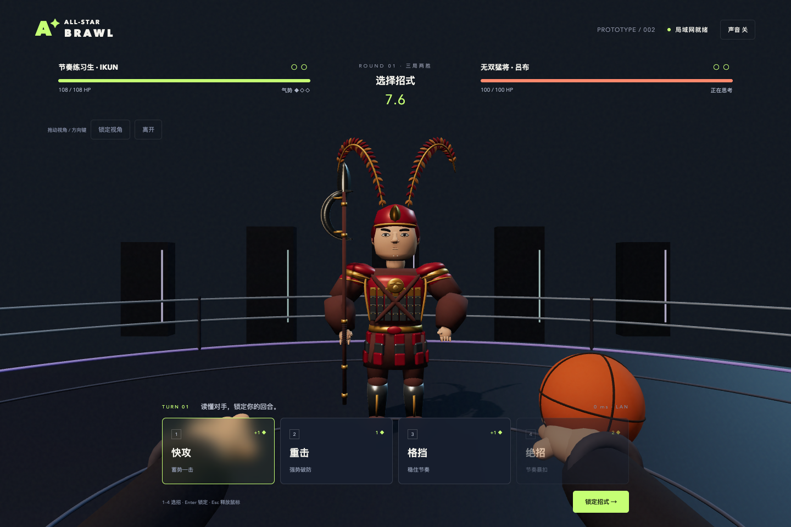
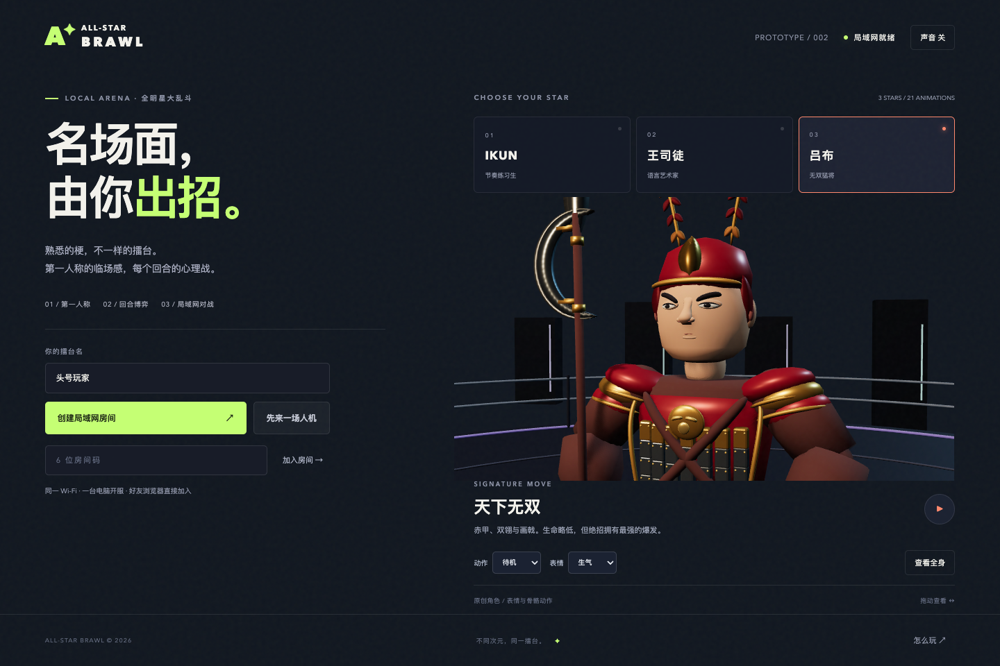

# v0.2.0 验证记录

日期：2026-10-13。测试环境：macOS、Node.js 25.9.0、Blender 5.1.1、桌面 Chrome。兼容目标：Node.js 22+。

## 自动检查

`npm run check`：**18 项全部通过**。

- GLB 文件完整性、16 骨骼蒙皮、每名角色七个动画片段及四个独立面部形态；每模型低于 8 万三角形、5 MiB。
- 实际加载 GLB 后，用射线确认生气时眼白和瞳孔仍可见；微笑和疼痛不会继承眨眼的变形。
- 攻击包含前摇、620 ms 接触和时段内收招；命中停顿不会延迟下一段。
- 30 / 60 / 144 fps 下镜头恢复一致；格挡先于命中抬起，武器接触点在镜头前。
- 无效招式、气势不足、默认格挡与气势上限。
- 普通伤害、重击破防、三名角色绝招和王司徒的气势消耗。
- 双方从同一状态结算，支持双 KO；生命比例判胜。
- 回合重置保留玩家与比分。
- 两个真实 WebSocket 客户端的建房、加入、开始与对战。
- 对手招式在选招阶段保持隐藏，锁定后不可修改。
- 超时自动格挡、人机陪练和房间清理。
- 断线后房间回到准备阶段。
- 无效消息、满房间、伪造伤害、私有文件路径和跨源连接。
- 平局重开同一局、两胜结束与房主再战。

依赖版本未改变。首版 `npm audit --omit=dev --audit-level=high` 结果为 **0 个已知漏洞**。

## 真实浏览器

使用已有 Playwright CLI 和 Playwright 运行环境驱动已安装的 Chrome，未增加项目测试依赖。录像没有录制音轨，游戏内仍可开启合成音效。

- 1440 × 960 画面：三个角色逐一检查，全身、脸部特写、六个单次/庆祝动作及待机均实际播放并截图。
- 检查自然、生气、疼痛、开心四种状态；修复厚眼皮、脸颊凸线、尖鼻，以及表情误继承眨眼的问题。
- 同一台 Mac 的两个独立浏览器会话：主机使用回环地址，客端使用本机真实 LAN IPv4 地址。通过大厅加入、房主开始和连续七回合选招，检查快攻、重击、双方绝招、格挡与低生命状态。
- 七回合后主机 **19 / 108 HP**，客端 **37 / 100 HP**；双方规则正常推进，离开返回大厅。
- 修正第一人称格挡的前臂方向，避免袖口挡住拳头；命中姿势、回收和短促特效按实际对战录像检查。
- 最终对战没有 JavaScript 页面错误。

另外检查王司徒与吕布的第一人称格挡：手部、羽扇、画戟正常显示，开启和关闭声音均无页面错误。当前预览控件在 390 像素宽度下可操作，页面没有横向溢出。

首版另外验证过：人机整场胜负、再战重置、断线回准备阶段，以及玩法弹窗。

预览：

[人物表情与对战录像](presentation-preview.mp4)（约一分钟，无录制音轨）。

## 尚未验证

真实两台设备、不同路由器与 Wi-Fi 隔离设置；Firefox / Safari；公网部署；长期运行与大规模并发；玩家对手感的主观评价。当前交付为可运行的 1v1 局域网风格化原型，没有布料或头发物理，仍可继续雕刻和精修动作。
