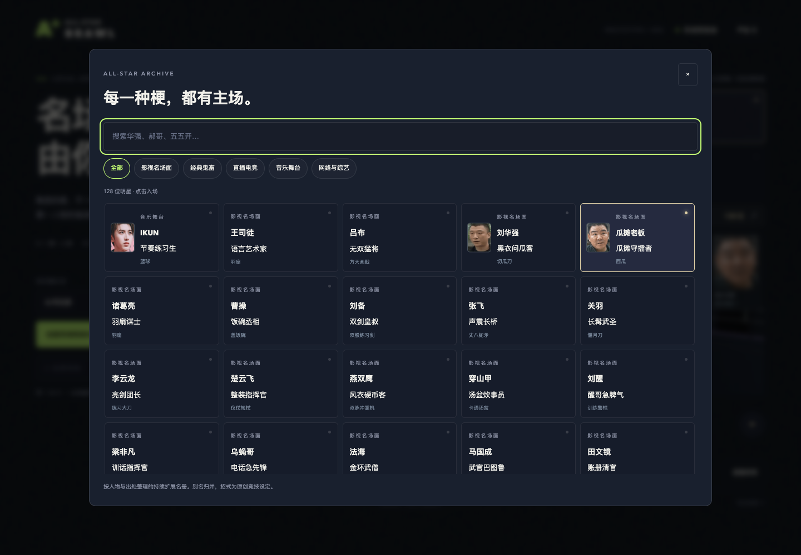
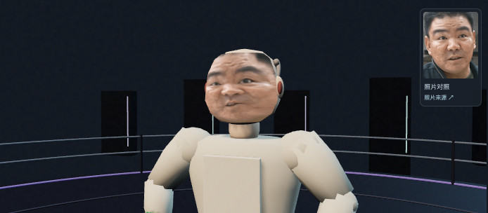
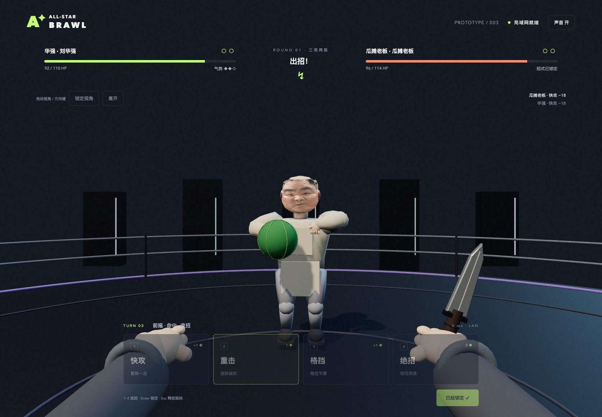

# v0.3.0 验证记录

日期：2026-10-13。测试环境：macOS、Node.js 25.9.0、Blender 5.1.1、桌面 Chrome。兼容目标：Node.js 22+；GitHub Actions 使用 Node.js 22。

## 自动检查

`npm run check`：**23 项全部通过**。

- 128 位目录与模型逐项对应，别名、分类、出处、属性、实际动作族和接触点齐全。
- 每位至少 16 根兼容骨骼，四种表情具有非零、彼此不同的形变；模型均低于 8 万三角和 5 MiB。
- 原三位各七个内嵌动作；其余模型没有重复动画数据，四个共享库各有七个兼容片段，合计 49 个实际片段。
- 三份照片脸各内嵌一张图片，无外部图片 URI，绑定照片材质及有效 UV；其余模型没有图片依赖。
- 王司徒与吕布用实际加载的 GLB 射线检查：生气时虹膜与眼白仍可见，独立表情不继承眨眼。
- 攻击前摇、620 ms 接触、收招与命中停顿；30 / 60 / 144 fps 镜头恢复一致，格挡与所有人物武器接触点均在镜头前。
- 全角色战斗规则、气势消耗和上限、默认格挡、破防、双方同时结算、双 KO、按生命比例判胜和回合重置。
- 两个真实 WebSocket 客户端建房、加入、开始、隐藏招式、锁定不可修改与对战；另有华强对瓜摊老板的专门两客户端检查。
- 超时、人机、断线、房间清理、满房、无效消息、伪造伤害、私有路径、跨源连接、平局重开及房主再战。

运行依赖仍是 Three.js 与 ws，没有新增浏览器测试依赖。

## 资源统计

| 资源 | 数量与规模 |
| --- | --- |
| 可选角色 | 128 位；影视 43、经典 22、直播电竞 11、音乐 23、网络综艺 29 |
| 新增模型 | 125 个不同 GLB，合计 73,210,200 bytes，约 69.8 MiB |
| 新增单体 | 352,808–1,566,904 bytes；10,524–22,716 三角面 |
| 三份照片版 | IKUN 3,422,368 bytes / 44,760 三角；华强 1,098,736 bytes / 21,408 三角；瓜摊老板 1,566,904 bytes / 22,716 三角 |
| 动作 | 原三位 21 片段 + 四库 28 片段 = 49；共享不等于每人独占七套新动作 |
| 常用角色与缓存 | 首页 6 位，选择时载入，缓存最多 12 个；清理模型时释放几何、材质和照片纹理 |

## 真实浏览器与画面观察

使用已有 Playwright CLI 及运行环境驱动已安装的 Chrome，未安装额外运行环境。桌面检查画面为 1440×1000。

- 前 108 位与补充 20 位逐个通过真实图鉴选择，播放绝招，并保存动作画面与生气脸部截图；128 位均成功加载，检查图片汇总后没有缺失人物或空模型。
- 验证各分类人数、别名「五五开」找到卢本伟、空搜索结果，以及 390 像素宽度下图鉴与页面没有横向溢出。
- 连续快速选择 17 个角色，模拟资源延迟完成；缓存仍为 12 个。修正了过期加载完成后未清理缓存的情况。
- 修正华强衣领与口袋、瓜摊老板稀发及年长造型；检查了西游三位的猴脸、法帽、猪鼻、垂耳与道具。
- 第一人称实际查看悟空棍、唐僧九环杖、猪八戒九齿耙、郭德纲/于谦折扇、成龙/吴京双拳套，并播放格挡。道具各自显示，折扇没有误用羽扇。
- 三位照片脸检查自然、生气、开心、疼痛及侧脸，照片对照与头像正常显示；没有双套眼口。修正了本地 GLB 图片的 Blob 加载限制，并检查了图像和表情的实际浏览器显示。
- 图片脸缘经过额、颊、下巴轮廓重映射，避免把源照片的背景、衣领映到脸部边缘；头部保持立体曲面，具有浅鼻梁与鼻尖。

## 联机与延迟加载

同一台 Mac 的两个独立浏览器会话，主机使用回环地址，客端使用 en0 网卡上的真实局域网 IPv4 地址；这不是两台独立设备的测试。

先在客端故意延迟华强模型，直到一记重击命中默认格挡后才放行。客端显示 **90 / 114 HP**，模型入场后仍是 **90 / 114 HP**，没有回跳；角色跟上正在执行的动作。已修正迟到模型重置显示生命值、错过动作的问题；对手未入场时鼠标和键盘选招均等待模型。

最终照片版华强对瓜摊老板连续四回合，包含双方快攻、重击对格挡、瓜摊老板绝招对格挡、华强绝招对格挡。最终主机 **82 / 110 HP**，客端 **62 / 114 HP**。招式、生命、气势和回合按服务器状态正常推进，**没有 JavaScript 页面错误或控制台警告**。

## 演示

[128 位图鉴、三位照片脸与第一人称联机实机录像](roster-demo.mp4)：44.76 秒，1440×1000，25 fps；没有录制音轨。游戏内可开启合成音效，录像不用于证明实际听感。

v0.2 的三位原始风格人物与表现检查仍可在 [历史演示](presentation-preview.mp4) 查看。

## 实际限制

128 位是持续扩展的调研集合，不是固定官方全集。多数模型通过服装、发型、体型和配件组合生成，26 位核心配置经过专门调整；照片版只完成三位。

华强原照片低清，转头照片的脸 UV 会产生局部拉伸；侧面、肤色接缝和闭眼形态仍可精修。现有动作共享四类新库，没有逐人为独占招式做动作捕捉、头发或布料物理。

未验证真实两台设备、不同路由器与 Wi-Fi 隔离设置、Firefox / Safari、公网部署、长期运行、大规模并发，以及玩家对打击感和平衡的主观评价。稀有事件与武器夺取仍属于 [玩法提案](LOOT_AND_DRAMA_DESIGN.md)，本版尚未实现。
